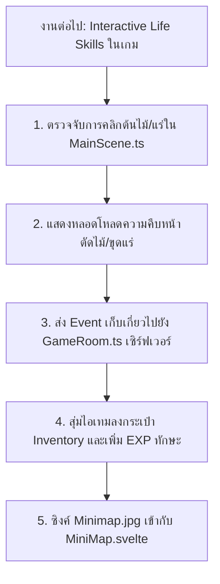

# 🚀 DRAMI ONLINE: MASTER SYSTEM STATE & AI CONTINUATION GUIDE
> **เอกสารสำคัญที่สุดสำหรับ AI Assistant และ Developer**: เมื่อเปิด session / CLI ใหม่ ให้อ่านไฟล์นี้เป็นอันดับแรก จะเข้าใจสถาปัตยกรรม ค่าแวดล้อม งานที่เสร็จแล้ว และสิ่งที่ต้องทำต่อได้ทันที 100%

---

## 1. ข้อมูลระบบออนไลน์ & สภาพแวดล้อมจริง (Live Production & Credentials)

| รายการ | รายละเอียด | หมายเหตุ |
| :--- | :--- | :--- |
| **Frontend Web Game** | **[https://drami.vercel.app](https://drami.vercel.app)** | โฮสต์บน Vercel (SvelteKit 2 + Phaser 3 + Tailwind CSS v4) |
| **Backend Server** | **[https://drami-zxd44.onrender.com](https://drami-zxd44.onrender.com)** | Node.js + Colyseus v0.16 + Express (Region: Singapore) |
| **WebSocket Endpoint** | `wss://drami-zxd44.onrender.com` | เชื่อมต่อแบบ Real-time State Sync อัตโนมัติ |
| **GitHub Repository** | **[https://github.com/ZXD44/Drami-ZXD44](https://github.com/ZXD44/Drami-ZXD44)** | Branch หลัก: `main` |
| **บัญชีผู้ดูแลระบบ (Admin)** | **Username:** `ZirconX`<br/>**Password:** `123456` | ได้รับยศ `admin` อัตโนมัติ (มีดาวทอง `⭐ ZirconX ⭐` บนหัวและแชท) |

---

## 2. การจัดการ Environment Variables & API Keys (`.env`)

### ฝั่ง Server (`server/.env` & Render Dashboard)
```env
DATABASE_URL="file:./prisma/dev.db"
PORT="2567"
CLIENT_ORIGIN="https://drami.vercel.app"
JWT_SECRET="drami_secret_key"
```
* **Render Deploy Hook**: `https://api.render.com/deploy/srv-dbks9ioae00c73bulnjg?key=xayckHsdu6Y` (ใช้ยิง curl POST สั่ง deploy ใหม่ได้ทันที)
* **Render API Key**: `rnd_DXwo3S6F9VI8w36If4oe4rVg5UHN` (Service ID: `srv-dbks9ioae00c73bulnjg`)
* **ฐานข้อมูล**: SQLite (`server/prisma/dev.db`) ถูกตั้งค่า `url = "file:./prisma/dev.db"` ใน `schema.prisma` โดยตรงเพื่อเลี่ยงปัญหา env ในช่วง build

### ฝั่ง Client (`client/.env` & Vercel Dashboard)
```env
VITE_SERVER_URL="https://drami-zxd44.onrender.com"
VITE_IMGBB_API_KEY="1aa357e65c7f52d080aa13859e6040ec"
```
* **ImgBB API**: ใช้สำหรับระบบอัปโหลดรูปภาพโปรไฟล์/อวตารของผู้เล่น
* **Dynamic Fallback ในโค้ด ([`client/src/lib/game/config.ts`](client/src/lib/game/config.ts))**:
  * ถ้ารันบน `localhost` หรือ `127.0.0.1` จะชี้ไปที่ `http://localhost:2567`
  * ถ้ารันบน Web Production จะเชื่อมต่อไปยัง `https://drami-zxd44.onrender.com` อัตโนมัติ

---

## 3. สรุปประวัติการพัฒนาและสิ่งที่ทำสำเร็จแล้ว (Completed Log)

### หมวดที่ 1: ระบบโครงสร้างพื้นฐาน & Deployment (Infra)
1. **ฟรีโฮสติ้ง 100%**: Client ขึ้น Vercel Edge Network และ Server ขึ้น Render Node.js Singapore (Latency ต่ำสุด)
2. **ผูกโดเมนสั้น**: ใช้ **`drami.vercel.app`**
3. **แก้ปัญหา Build & Author บน Vercel/Render**: ปรับ Node Engine เป็น 22.x, ย้าย TypeScript/Prisma เป็น dependencies หลัก, แก้ไขปัญหา Commit author permission ด้วยอีเมล `sahaphumx@gmail.com`
4. **CI/CD Workflows**: สร้างเทมเพลต GitHub Actions ใน `.workflow/deploy/`

### หมวดที่ 2: ระบบความปลอดภัยระดับสูง (DramiShield & Anti-Cheat)
1. **Server Authoritative Anti-Teleport (`server/rooms/GameRoom.ts`)**: คำนวณ Displacement Vector ทุก Tick หากผู้เล่นเคลื่อนที่ข้ามพิกัดผิดปกติจะปฏิเสธและสั่ง **Snapback** ดึงตัวกลับทันที
2. **Chat Sanitization & Anti-Spam**: จำกัดความยาวข้อความ 150 ตัวอักษร ป้องกัน Buffer Overflow และการยิง Payload
3. **Client-Side Anti-DevTools (`client/src/lib/security/DramiShield.ts`)**: ดักจับปุ่ม F12, Ctrl+Shift+I, ป้องกันการเปิด Console สำหรับผู้เล่นทั่วไป (ยกเว้น Admin)

### หมวดที่ 3: โครงสร้างและทรัพยากรเกมใหม่ (Drami-MMORPG Merge)
1. **แมพโลกกว้าง (`client/static/assets/map/world.json`)**: นำเข้าแมพ Tiled 32x32 ครบ 3 เลเยอร์ (`Grass`, `Decorations`, `Objects`) พร้อมขยาย Bounds กล้อง
2. **เปลี่ยนสไปรท์ตัวละคร**: ลบโฟลเดอร์ LPC 1GB ทิ้ง และเปลี่ยนมาใช้สไปรท์คลาสสิก 32x32 (`player-sprite.png`, `other-player-sprite.png`) เบา โหลดไว คมชัด
3. **เคอร์เซอร์ RPG โบราณ**: ใช้งาน `cursor-brown.cur`
4. **ระบบควบคุม Mobile / iPad**: สร้าง [`VirtualJoystick.svelte`](client/src/lib/game/components/VirtualJoystick.svelte) บริเวณนิ้วโป้งซ้าย รองรับการสัมผัส 360 องศา และซ่อนอัตโนมัติบนคอมพิวเตอร์
5. **Modern Vector UI (100% SVG Migration)**: ปลดระวางอีโมจิทั้งหมดในเกม เปลี่ยนมาใช้ไอคอน Vector SVG คมกริบผ่าน [`Icon.svelte`](client/src/lib/game/components/Icon.svelte) ครบทุกโมดูล:
   - Navigation HUD & Main Menu (Quest, Skills, Party, Settings, Admin, Logout, Bag, Camera)
   - Admin Panel (DashboardTab, PlayersTab, BroadcastTab, EditUserModal)
   - Overlays & Popups (QuestLogPanel, InventoryPanel, PartyPanel, SkillPanel)
   - NotificationSystem, PlayerHUD, MiniMap, Hotbar, AvatarCreator, Register page

### หมวดที่ 4: ระบบควบคุมโลก & แอดมินเรียลไทม์ (Live World Orchestrator)
1. **ระบบรีโหลดหน้าเว็บของผู้เล่นทุกคน (Global Force Reload)**:
   - สั่งผ่าน Endpoint `/api/admin/reload-all` หรือข้อความ `admin_reload_all` จากแผงควบคุมแอดมิน
   - ไคลเอนต์ทุกคนจะได้รับ Event `force_reload` พร้อมแจ้งเตือน Notification แล้วสั่ง `window.location.reload()` ทันที
2. **ระบบบันทึกจุดเกิดของผู้เล่น (Spawn Coordinates Persistence)**:
   - เพิ่มคอลัมน์ `spawnX`, `spawnY` ในตาราง `User` และซิงค์ลง `@type("number") spawnX`, `spawnY` ใน Colyseus `Player`
   - แอดมินสามารถคลิก "ตั้งพิกัดปัจจุบันเป็นจุดเกิด" ได้แบบเรียลไทม์ และตัวละครจะเกิดตรงจุดนั้นเสมอ
3. **ระบบจัดการแมพและเอนทิตี ([`MapEditorTab.svelte`](client/src/lib/game/admin/MapEditorTab.svelte))**:
   - แท็บ "จัดการแมพ/จุดเกิด" ใน Admin Panel
   - ปรับแต่งและตรวจสอบขอบเขตแมพ (Width/Height Px & Tiles)
   - วางจุดเกิดมอนสเตอร์, NPC เควส, ทรัพยากร (Resource Nodes), และประตูวาร์ป (Teleport Portal) ตรงตำแหน่งพิกัดที่ผู้เล่นยืนอยู่พร้อมระบบบันทึกเอนทิตี

---

## 4. แผนงานที่ต้องทำต่อทันที (Next Action Items for AI)



1. **ระบบเก็บเกี่ยว Life Skills ในแผนที่ (Harvesting & Gathering)**:
   * ใน `MainScene.ts` เพิ่มการตรวจจับ Input Pointer กับ Objects ในแผนที่ (ต้น Beech, ต้น Maple, กองหินแร่)
   * เมื่อผู้เล่นอยู่ในระยะ (<= 64px) และคลิกที่ต้นไม้ ให้เล่นอนิเมชันตัดไม้ พร้อมแสดง Progress Bar เหนือหัว
   * เมื่อตัดสำเร็จ ส่งข้อความ `harvest_resource` ไปยัง Colyseus Server (`GameRoom.ts`)
2. **ระบบดรอปไอเทม & EXP ทักษะ (Server Authoritative)**:
   * เซิร์ฟเวอร์ตรวจสอบระยะห่าง แล้วสุ่มดรอปไอเทม (เช่น `log_beech_item` หรือ `mining_ore`) ลงตาราง `Inventory` ในฐานข้อมูล
   * เพิ่มค่า EXP ในทักษะ `woodcutting`, `mining`, หรือ `farming` ใน `$skills`
3. **ปรับแต่ง Minimap ให้ตรงกับแมพจริง**:
   * นำภาพ [`client/static/assets/map/minimap.jpg`](client/static/assets/map/minimap.jpg) มาแสดงเป็นพื้นหลังใน [`MiniMap.svelte`](client/src/lib/game/components/MiniMap.svelte) พร้อมคำนวณสัดส่วนพิกัดผู้เล่น 150x150 tiles

---

## 5. กฎระเบียบสำหรับ AI ในการเขียนโค้ด (Coding Invariants)
* **ห้ามปน Render Pipeline**: Phaser คุม Canvas/Sprite/Map เท่านั้น ส่วน Svelte คุม HUD/Modals/UI
* **Mobile First**: ทุกหน้าต่าง Modal/Overlay ต้องรองรับการแตะบนมือถือแนวนอน (Touch Friendly)
* **No Emojis for UI**: ให้ใช้ `<Icon name="..." />` จาก `Icon.svelte` เท่านั้นสำหรับปุ่มและสัญลักษณ์ UI
* **Clean Repo**: ห้าม commit โฟลเดอร์ asset ขนาดใหญ่หรือไฟล์ทดสอบที่ไม่จำเป็นลง Git
