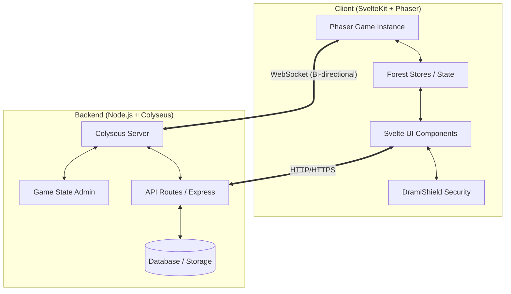

# 🛡️ Drami Online - Technical Architecture & Systems Design

ยินดีต้อนรับสู่คู่มือการออกแบบระบบ (Technical Design) สำหรับโปรเจค **Drami Online** เอกสารฉบับนี้รวบรวม Logic, Workflow และ Algorithm ของระบบที่เพิ่ง Refactor เสร็จสิ้น เพื่อเป็นพิมพ์เขียวสำหรับการพัฒนาต่อยอดในเย็นวันนี้

---

## 🏗️ 1. Overall System Architecture (High-Level)

โครงสร้างปัจจุบันใช้รูปแบบ **Client-Server Architecture** ที่แยกส่วนความรับผิดชอบชัดเจน (Separation of Concerns)



---

## 🔄 2. Game State Workflow (The Movement Logic)

ระบบการเคลื่อนที่และการ Sync ข้อมูลระหว่างผู้เล่น (Multiplayer Sync)

### 🛰️ Algorithm: Client-Side Prediction (Simplified)
1. **Input Detection:** เมื่อผู้เล่นกดปุ่ม WASD ใน Phaser
2. **Local Move:** ตัวละครขยับทันทีบนหน้าจอของผู้เล่น (เพื่อความลื่นไหล - *Latency Compensation*)
3. **Emit Event:** ส่งพิกัด `{x, y}` ผ่าน `room.send("move", ...)` ไปยังเซิร์ฟเวอร์
4. **Server Validation:** เซิร์ฟเวอร์ตรวจสอบความเร็ว (Speed Hack Check) และอัปเดต State
5. **Broadcast:** เซิร์ฟเวอร์ส่งพิกัดไปยังผู้เล่นคนอื่นที่อยู่ใน Room เดียวกัน

---

## 🛡️ 3. Security Architecture (DramiShield)

ระบบป้องกันการโกงและการดัดแปลง UI

### 🔒 Logic & Workflow:
*   **Anti-DevTools:** ใช้ระบบ De-optimized loop และดักจับการเปลี่ยนแปลงขนาด Window เพื่อป้องกันการเปิด Console
*   **UI Integrity:** ระบบจะตรวจสอบว่าไฟล์ CSS หลักและ Component สำคัญยังอยู่ครบและไม่ถูกซ่อน (CSS Attribute Check)
*   **Token-Based Auth:** ทุกการร้องขอ (Request) จาก Client ไปยัง Admin API ต้องมี `Bearer Token` ใน Header เสมอ

---

## 🎨 4. Modular UI System (Phase 4 Cleanup)

เราได้แยก UI ออกเป็น **Overlays Architecture** เพื่อลดขนาดโค้ดในไฟล์หลัก

### 📂 Logic การจัดการเมนู:
ใช้ระบบ **Toggle State Manager** ใน `+page.svelte`:

```javascript
// Workflow การเปิด/ปิดหน้าต่าง
function togglePanel(panel) {
   closeAllPanels(); // ปิดทุกอย่างก่อน (Single active window pattern)
   if (!isOpen) { 
       showXXX = true; // เปิดเฉพาะหน้าต่างที่เลือก
   }
}
```

*   **Chat System Algorithm:** ใช้ `svelte/store` (`chatFeed`) เชื่อมต่อกับ `ChatPanel`. เมื่อมีข้อความใหม่ (Message Event) -> Push เข้า Array -> Svelte อัปเดต DOM อัตโนมัติ -> สั่ง `scrollChatToBottom()`

---

## 🔥 5. Roadmap: Evening Development (เย็นวันนี้)

นี่คือ "Algorithm & Workflow" ที่แนะนำให้เริ่มทำเย็นนี้:

### 👾 5.1 ระบบ Monster AI (NPC Logic)
*   **State:** มอนสเตอร์มีสถานะ `IDLE` (ยืนเฉยๆ), `PATROL` (เดินสุ่ม), `CHASE` (วิ่งไล่), `ATTACK` (โจมตี)
*   **Distance Algorithm:** 
    ```typescript
    const dist = Math.sqrt((player.x - mob.x)**2 + (player.y - mob.y)**2);
    if (dist < detectionRange) state = 'CHASE';
    ```

### ⚔️ 5.2 ระบบ Combat (Hitting Logic)
*   **Workflow:**
    1. ผู้เล่นกดปุ่ม Skill (1-4)
    2. Client ตรวจสอบระยะกะระยะ (Visual Check)
    3. ส่งคำสั่งโจมตีไป Server
    4. **Critical Logic:** เซิร์ฟเวอร์เป็นคนตัดสินว่า "โดนหรือไม่" (Server-side Truth) และลดเลือดมอนสเตอร์

---

## 📝 6. บันทึกโครงสร้างไฟล์ล่าสุด (After Refactor)

*   `server/src/routes/`: จัดการ API (Login, Register, Admin)
*   `client/src/lib/game/game-ui.css`: สไตล์ UI ทั้งหมด (แยกจาก Component)
*   `client/src/lib/game/components/overlays/`: รวมไฟล์หน้าต่างระบบ (Inventory, Skills, Party)
*   `client/src/routes/game/+page.ts`: ปิด SSR เพื่อให้ Phaser ทำงานได้ราบรื่น

---

> [!TIP]
> **คืนนี้:** เน้นการเชื่อมต่อ "Action" ระหว่าง Phaser กับ Server ครับ (เช่น การกดตีมอนสเตอร์แล้วเลขดาเมจเด้งขึ้นมา)

---
เอกสารจัดทำโดย **Antigravity (Technical Architect)**
